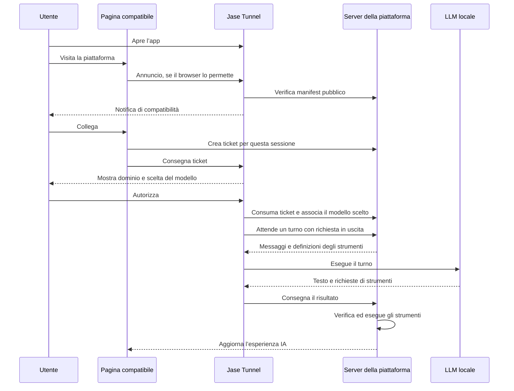

# Jase Tunnel Web Protocol

Bozza di progetto 0.1 · 17 ottobre 2026 · identificatore proposto: `jase-tunnel-v1`.

Questa è la specifica proposta. La versione 0.2 implementa scoperta, verifica di rete, ricevute, consenso nativo, collegamenti con modello fissato, broker/SDK e installatore Next.js; conserva `jase-companion-v1` separato. Sono ancora proposte le notifiche di sistema con silenziamento, l’estensione a framework non adattati e il collaudo completo della matrice browser. Non si dichiara ancora uno standard pubblico completo. I termini DEVE, NON DEVE e DOVREBBE indicano requisiti della proposta.

## 1. Esperienza dell’utente

**Scarichi Jase Tunnel, lo apri, visiti una piattaforma compatibile e l’app ti avvisa che puoi usare la tua LLM con gli strumenti di quella piattaforma.**

1. L’app rimane in esecuzione e rileva i modelli locali disponibili.
2. La pagina compatibile si annuncia al tunnel, quando il browser consente il contatto locale.
3. Il tunnel verifica la dichiarazione del sito e mostra: «Questo sito supporta Jase Tunnel: piattaforma.example».
4. L’utente sceglie «Collega» sulla pagina. L’app mostra il dominio verificato, i dati scambiati e il selettore del modello; l’utente conferma nell’app.
5. Gli strumenti IA della piattaforma usano il modello scelto. Il pannello mostra i collegamenti attivi e permette di interromperli.

Non occorre un account Jase Tunnel o un’estensione obbligatoria. La piattaforma conserva i propri requisiti di accesso: il tunnel non rende anonimo un servizio che richiede un account.

La notifica annuncia la compatibilità; l’accesso al modello richiede il consenso nell’app. Una piattaforma compatibile può essere rilevata anche quando non ci sono modelli pronti: l’app spiega come avviare Ollama o LM Studio.

### Il primo contatto nel browser

Una normale app desktop non riceve automaticamente gli URL visitati. Il sito DEVE collaborare eseguendo il client web del protocollo. Il solo manifest pubblicato sul server non avvisa l’app.

Il browser può richiedere un permesso per contattare il servizio locale. Quando è necessario, la pagina mostra «Rileva Jase Tunnel» e una spiegazione; il tentativo parte da un’azione dell’utente. Quando il permesso è già disponibile, il sito può annunciarsi all’apertura della pagina. Le prove devono verificare questo comportamento per ciascun browser supportato.

Pertanto l’esperienza automatica è garantibile **dopo il consenso richiesto dal browser e finché pagina e app sono attive**. Senza contatto, l’app mostra «In attesa di siti compatibili»; non può stabilire che il sito visitato sia incompatibile. Una richiesta ricevuta identifica l’origine che ha contattato l’app, non prova che sia la scheda in primo piano.

## 2. Base presente nel repository

| Componente | Codice presente | Evoluzione necessaria |
| --- | --- | --- |
| Servizio locale | `main.go`, ascolto su `127.0.0.1:11439` | API di scoperta separate dalle operazioni autorizzate |
| Origini | `allowedOrigin`, Jase in produzione e loopback in sviluppo | Verifica di siti HTTPS e autorizzazione esplicita per collegamento |
| Associazione | Ticket del browser scambiato dal tunnel con il server | Consenso nell’app, modello scelto, scadenza e revoca |
| Trasporto | `protocol.go`, richieste in uscita al broker del sito | Profilo interoperabile e credenziali separate per sito e sessione |
| Inferenza | `models.go`, Ollama e LM Studio locali | Applicazione dei limiti e del modello autorizzato a ogni turno |
| Strumenti | Schemi `tool`, richieste `toolCall` | La piattaforma continua a verificare ed eseguire le proprie funzioni |
| Interfaccia | AppKit su macOS, Win32 su Windows, GTK 3 su Linux | Elenco siti, notifiche e controlli di autorizzazione su tutti i sistemi supportati |
| Riservatezza | Token e percorsi completi conservati localmente | Nessun inventario o identificatore di altri siti nelle nuove API |

Il backend e il frontend Jase non sono inclusi in questa cartella. Anche Jase dovrà integrare la nuova scoperta e il nuovo broker.

## 3. Componenti e responsabilità

Ogni piattaforma integra tre elementi: un manifest pubblico, un piccolo client nella pagina e un broker sul proprio server. Il tunnel fornisce scoperta, consenso, collegamento e adattatori dei modelli.



Il server mantiene l’orchestrazione già prevista dal codice: riceve le richieste dell’utente, costruisce i turni, esegue gli strumenti e aggiorna la pagina. Tutti i collegamenti remoti del tunnel partono dal computer verso il server della piattaforma. Non serve aprire porte sul router o usare un relay di terzi.

Il sito DEVE esporre ogni strumento utilizzabile come funzione con nome, descrizione, schema JSON degli argomenti ed esecutore autorizzato sul server. Pubblicare il manifest da solo non rende disponibili alla LLM tutte le funzioni dell’interfaccia.

## 4. Dichiarazione di compatibilità

Percorso fisso per ogni origine:

```text
GET https://piattaforma.example/.well-known/jase-tunnel.json
Content-Type: application/json
```

Esempio:

```json
{
  "name": "Piattaforma Esempio",
  "protocols": ["jase-tunnel-v1"],
  "broker": "/api/jase-tunnel/v1/",
  "requirements": {
    "capabilities": ["chat", "tool-calls"],
    "contextTokens": 16384
  }
}
```

Il manifest DEVE rispettare queste regole:

- `name`: testo di presentazione da 1 a 80 caratteri. L’app visualizza sempre anche il dominio effettivo e tratta il nome come testo non attendibile.
- `protocols`: elenco delle versioni implementate. Questa revisione richiede `jase-tunnel-v1`.
- `broker`: percorso assoluto sulla medesima origine, con `/` finale. Sono vietati URL assoluti, prefissi `//`, query, frammenti, backslash, segmenti `.`/`..` e loro forme codificate. Il tunnel verifica nuovamente l’origine dell’URL risultante.
- `requirements.capabilities`: sottoinsieme di `chat`, `tool-calls`, `json-schema`; `chat` è obbligatorio. Una capacità richiesta sconosciuta rende il profilo incompatibile.
- `requirements.contextTokens`: intero tra 2048 e 262144. L’app offre solo modelli con capacità e contesto sufficienti.
- Dimensione massima: 16 KiB. I campi obbligatori mancanti o di tipo errato invalidano il manifest. Campi aggiuntivi vengono ignorati e non concedono autorizzazioni.

La pagina può dichiarare anche:

```html
<link rel="jase-tunnel" href="/.well-known/jase-tunnel.json">
```

Il riferimento HTML serve agli integratori; l’app verifica sempre il percorso fisso sull’origine ricevuta dal browser. Il corpo dell’annuncio non può indicare un altro dominio o un URL da scaricare.

## 5. Scoperta locale

Base locale proposta: `http://127.0.0.1:11439/tunnel/v1/`. La porta appartiene alla convenzione del protocollo e non è una porta ufficialmente assegnata. Il profilo base non effettua scansioni di porte o reti. Porte alternative rimangono configurazione esplicita di sviluppo.

### Annuncio

La pagina invia:

```http
POST /tunnel/v1/discover
Origin: https://piattaforma.example
Content-Type: application/json

{"protocol":"jase-tunnel-v1"}
```

Il tunnel prende il sito esclusivamente dall’header `Origin` verificato. Risponde `202` con:

```json
{
  "protocol": "jase-tunnel-v1",
  "discoveryId": "<identificatore casuale>",
  "receipt": "<segreto temporaneo>",
  "expiresAt": 1792245900000,
  "state": "verifying"
}
```

`discoveryId` usa 16 byte casuali codificati in esadecimale; `receipt` usa 32 byte casuali codificati in esadecimale. La ricevuta è valida per cinque minuti, resta in memoria nella pagina e nel tunnel ed è vincolata all’origine. Non rappresenta una credenziale di inferenza. L’esempio temporale usa millisecondi Unix.

Il tunnel scarica il manifest pubblico senza cookie o credenziali. Se il manifest è valido, passa allo stato `compatible` e può notificare l’utente. La verifica prova che il dominio dichiara il protocollo; non certifica reputazione o affidabilità della piattaforma.

### Stato della propria richiesta

```http
GET /tunnel/v1/discovery
Origin: https://piattaforma.example
Authorization: Bearer <receipt>
```

La risposta `200` contiene `protocol`, `discoveryId`, `expiresAt` e `state`. Dopo il collegamento può contenere esclusivamente il `connectionId` di questa associazione. Non restituisce nomi dei modelli, file, registro, credenziali del dispositivo o altre connessioni.

Stati: `verifying`, `compatible`, `awaiting_approval`, `connecting`, `connected`, `incompatible`, `rejected`, `failed`, `expired`. `compatible` indica il superamento della verifica statica; il broker sarà verificato durante l’associazione. Gli stati terminali sono `connected`, `incompatible`, `rejected`, `failed` ed `expired`. Una ricevuta scaduta o sconosciuta produce `410 discovery_expired`; una ricevuta di un’altra origine produce `403 origin_mismatch` senza esporre dati.

Il client interroga lo stato al massimo una volta ogni due secondi, interrompe le interrogazioni a uno stato terminale o alla scadenza e le sospende quando la pagina è nascosta. Non inserisce segreti in URL, log o archiviazione persistente del browser.

### Notifiche

L’app DEVE conservare una voce nel pannello anche quando le notifiche di sistema sono disabilitate. Il clic sulla notifica apre quel pannello e non concede permessi. Il pannello invita a tornare alla pagina per iniziare il collegamento.

La prima revisione prevede al massimo una notifica per origine ogni 24 ore e tre notifiche di scoperta ogni dieci minuti in totale. Le scoperte successive aggiornano il pannello senza ulteriori notifiche. L’utente può silenziare un sito e disattivare tutte le notifiche. Il tunnel non carica icone o altre risorse remote per comporre l’avviso.

Un annuncio non riattiva un collegamento interrotto o revocato. Le notifiche sono una funzione locale: il sito non riceve informazioni sul fatto che l’utente le abbia lette.

## 6. Consenso e associazione

Il broker espone `POST <broker>tickets`, chiamato dalla pagina sulla propria origine dopo il clic «Collega». Usa la sessione del sito, la sua protezione CSRF e `Cache-Control: no-store`. Il corpo è `{"protocol":"jase-tunnel-v1"}`. La risposta `200` contiene `protocol`, `ticket` ed `expiresAt`.

Il ticket usa 32 byte casuali in esadecimale, dura al massimo 120 secondi, è monouso ed è legato a origine e sessione del browser. Il sito conserva la sessione nei propri meccanismi di autenticazione e non la invia al tunnel.

La pagina consegna il ticket con:

```http
POST /tunnel/v1/pair
Origin: https://piattaforma.example
Authorization: Bearer <receipt>
Content-Type: application/json

{"protocol":"jase-tunnel-v1","ticket":"<ticket monouso>"}
```

Il tunnel accetta solo ricevute in stato `compatible` e risponde `202` con `discoveryId` e `state: "awaiting_approval"`. Una seconda richiesta sulla stessa ricevuta restituisce `409 pairing_in_progress`. Il ticket rimane in memoria fino al completamento o alla scadenza.

Prima di contattare l’endpoint remoto di associazione, l’app DEVE mostrare:

- Origine HTTPS verificata e nome dichiarato della piattaforma.
- Modello locale selezionabile tra quelli sufficienti per il profilo richiesto.
- Informativa: «Il sito invierà al modello i messaggi e i dati necessari. Testo generato e richieste di strumenti torneranno al server del sito».
- Durata del collegamento e pulsanti «Consenti» e «Rifiuta».

Il consenso produce una concessione legata a origine, broker, sessione associata, versione del protocollo, modello scelto e scadenza. Il server può chiedere inferenza soltanto con quel modello. Il consenso non autorizza amministrazione dell’app, accesso ai file, altri siti o altre sessioni.

In questa prima revisione il collegamento dura al massimo otto ore. Il consenso e la scadenza possono essere conservati privatamente per riprendere un collegamento non scaduto dopo il riavvio dell’app. La scadenza effettiva è il minimo tra quella locale e quella del server. Nuova sessione, modello, broker o versione maggiore richiedono una nuova associazione e consenso. Un modello non più disponibile mette in pausa il collegamento senza sostituzioni automatiche.

Dopo la conferma, il tunnel esegue `POST <broker>pair` con protocollo, ticket, etichetta locale del dispositivo e **solo il modello autorizzato**, incluso il suo limite di contesto. Il broker consuma il ticket atomicamente e restituisce `protocol`, `token`, `connectionId`, `expiresAt`. Token: 32 byte casuali esadecimali; identificatore pubblico: 16 byte casuali esadecimali. Il server limita la credenziale alla sessione e alla scadenza dichiarate.

Il tunnel salva concessione e credenziale nella cartella privata prima di avviare le richieste di lavoro. Il salvataggio fallito lascia lo stato `failed` e impedisce l’inferenza. Il browser vede solo il successo e il proprio identificatore pubblico tramite lo stato della ricevuta.

Scadenza del ticket durante l’attesa, rifiuto o chiusura dell’app interrompono l’associazione; il client può iniziare un nuovo tentativo su azione dell’utente. La ricevuta viene controllata anche prima dello scambio remoto. Un annuncio o un permesso del browser da soli non valgono come consenso al modello.

### Interruzione e revoca

Il pannello DEVE offrire «Interrompi collegamento» per singola associazione e per sito. L’azione blocca subito nuove inferenze, annulla quelle in corso, cancella credenziali e concessione locale e tenta la revoca remota. Il fallimento della rete non può ripristinare il collegamento locale.

Il broker espone `POST <broker>revoke` con la credenziale del dispositivo e rende inutilizzabile il token. La revoca dal sito, la scadenza o una risposta `401`/`403` sugli endpoint del dispositivo fanno interrompere il collegamento anche nell’app. La revoca non può annullare strumenti che il server ha già eseguito.

Il rinnovo oltre la scadenza richiede un nuovo ticket e una nuova conferma; «ricorda per sempre questo sito» rimane fuori dal profilo iniziale.

## 7. Trasporto dei turni

Il primo profilo riusa il funzionamento di `protocol.go`, con un percorso broker dichiarato dal sito. Gli endpoint del dispositivo richiedono `Authorization: Bearer <token>`, protocollo nel corpo JSON dei `POST` e `Cache-Control: no-store` nelle risposte.

| Endpoint relativo al broker | Metodo | Richiesta e risposta |
| --- | --- | --- |
| `pair` | POST | Ticket ed elenco di un modello → credenziale, identificatore e scadenza |
| `models` | POST | Modello autorizzato disponibile oppure elenco vuoto → `{"ok":true}` |
| `poll` | POST | `{"protocol":"jase-tunnel-v1"}` → `{"task":null}` oppure `{"task":{...}}` |
| `active?id=…` | GET | Identificatore del turno → `{"active":true}` oppure `false` |
| `result` | POST | `protocol`, `id`, `result` → `{"ok":true}` |
| `revoke` | POST | `{"protocol":"jase-tunnel-v1"}` → `{"ok":true}` |

Le risposte del broker usano `200` in caso di successo. `tickets` è riservato alla pagina e alla sua sessione; `pair` usa il ticket una sola volta; gli altri endpoint usano la credenziale del dispositivo. Il broker non deve mai accettare il `connectionId` come credenziale.

La struttura di `task`, `message`, `tool`, `toolCall` e `turn` parte dai tipi omonimi in `protocol.go`. Ogni messaggio contiene ruolo e contenuto; gli strumenti descrivono nome, descrizione e schema JSON degli argomenti; il risultato contiene testo e richieste di strumenti con argomenti JSON. Prima di pubblicare una versione stabile devono essere disponibili schemi JSON indipendenti dal Go e fixture condivise con l’SDK server.

Il tunnel DEVE verificare ogni turno contro la concessione locale, anche se il server richiede un modello differente. Richieste di strumenti o output strutturato richiedono le rispettive capacità negoziate. Il sito rimane responsabile di verificare nome e argomenti di ogni strumento rispetto alle definizioni inviate, permessi della sessione e conferme richieste per le azioni.

Limiti iniziali: 300 messaggi e 100 definizioni di strumenti per turno, massimo 6 richieste di strumenti nella risposta, massimo 16384 token di output, contesto entro quello del modello autorizzato, corpo del turno di massimo 1 MiB e durata di massimo dieci minuti e comunque entro la scadenza della concessione. Il broker restituisce un turno alla volta per collegamento; il tunnel esegue al massimo un’inferenza alla volta sul computer e rispetta la scadenza anche in coda.

Il broker termina ogni attesa `poll` entro venti secondi; il client usa un timeout di venticinque secondi. Il controllo `active` avviene ogni cinque secondi. Un turno non attivo, una credenziale revocata o tre controlli falliti consecutivi annullano l’inferenza, mantenendo la tolleranza ai brevi errori di rete già prevista. Non vengono consegnati risultati dopo cancellazione o scadenza.

Ogni turno ha un `id` univoco nell’associazione. Il broker accetta un solo risultato per `id`, tratta un reinvio identico come successo e non riesegue gli strumenti. Rifiuta risultati di altre associazioni, scaduti o cancellati. Il profilo iniziale usa risposte complete; streaming e rinnovo delle credenziali richiedono un’estensione futura.

Il modello viene eseguito sul computer, ma i contenuti della conversazione e gli argomenti degli strumenti passano dal server della piattaforma. I pesi, i percorsi locali e i token dei motori rimangono sul computer.

## 8. Confini delle API locali

Le nuove API separano le autorizzazioni per percorso:

| Superficie | Accesso |
| --- | --- |
| `POST /tunnel/v1/discover` | Origini HTTPS pubbliche idonee; sola creazione di una verifica |
| `GET /tunnel/v1/discovery` | Origine e ricevuta temporanea corrispondenti |
| `POST /tunnel/v1/pair` | Origine e ricevuta verificata; apertura di una richiesta di consenso |
| Inventario, selettori file, log, arresto, revoca locale | Interfaccia locale controllata dall’utente; mai concessi dalla scoperta web |
| Esecuzione di inferenza | Collegamento del broker autorizzato; nessun endpoint pubblico di inferenza sul loopback |

Il servizio DEVE ascoltare solo sul loopback e verificare esattamente l’header `Host`. Per i percorsi web richiede un solo `Origin` canonico valido; rifiuta origini opache, `null`, HTTP pubblico, userinfo, percorsi, query e frammenti. Il corpo non può sostituire l’origine.

Le risposte CORS DEVONO riflettere esclusivamente l’origine idonea per quello specifico percorso, con `Vary: Origin`, metodi previsti e soli header `Content-Type` e `Authorization`. Niente wildcard e niente credenziali CORS. Le modifiche richiedono JSON e limiti di corpo; un preflight non cambia lo stato e non produce una notifica. Le pagine locali di gestione devono avere una propria protezione contro richieste e incorporamenti da siti esterni.

La nuova scoperta NON DEVE usare la risposta attuale `/v1/status`: contiene disponibilità dei modelli, nomi di file e identificativi di collegamenti. Non basta trasformare `allowedOrigin` in «qualsiasi HTTPS»: oggi la stessa funzione protegge anche operazioni amministrative e destinazioni remote.

L’header `Origin` e CORS proteggono la superficie browser; non autenticano un altro programma già in esecuzione sul computer. Il consenso locale e l’isolamento delle credenziali restano necessari.

### Verifica di rete dei siti

La verifica di un dominio nuovo introduce richieste remote controllate da input web. Il tunnel DEVE:

- Ammettere in produzione solo origini HTTPS sulla porta 443 con nomi DNS pubblici; verificare normalmente i certificati TLS.
- Rifiutare destinazioni IP letterali, nomi locali e risoluzioni verso loopback, reti private, link-local, multicast, indirizzi riservati o non globalmente instradabili, incluse forme IPv4 in IPv6.
- Controllare tutti gli indirizzi ottenuti e vincolare la connessione a un indirizzo verificato, mantenendo hostname e SNI per TLS; ripetere il controllo a ogni nuova connessione anche al broker. Un semplice controllo DNS prima di una seconda risoluzione non basta.
- Disabilitare proxy automatici e redirect; nessun inoltro di credenziali verso un’altra origine. Limitare la verifica del manifest a cinque secondi, sedici KiB di corpo e otto KiB di header.
- Limitare a quattro verifiche concorrenti, venti richieste di scoperta al minuto globalmente e una verifica per origine al minuto; conservare al massimo cento richieste temporanee. Rispondere `429` con `Retry-After` quando necessario.

Le origini HTTP loopback restano possibili soltanto in modalità di sviluppo esplicita, con stato e concessioni separati da quelli di produzione. Non vengono abilitate da un campo del manifest.

### Errori

Formato comune:

```json
{"error":{"code":"unsupported_protocol","message":"Versione del protocollo non supportata."}}
```

Codici minimi: `invalid_request` (400), `unsupported_protocol` (400), `origin_mismatch` (403), `not_authorized` (403), `pairing_in_progress` (409), `discovery_expired` (410), `rate_limited` (429), `broker_unavailable` (502). I fallimenti asincroni espongono lo stato e un codice senza dettagli di rete interna, token o inventario locale. Le risposte non vengono memorizzate in cache.

## 9. Integrazione nel browser

Il futuro SDK web deve offrire scoperta, lettura dello stato e associazione, gestendo timeout, cancellazione e gli stati del browser. La pagina deve autorizzare il servizio loopback nella propria direttiva CSP `connect-src`. L’SDK deve operare nella pagina principale visibile; niente tentativi da iframe di terzi, service worker o schede nascoste.

La connessione usa `mode: "cors"`, `credentials: "omit"`, `redirect: "error"` e, dove supportato, `targetAddressSpace: "loopback"`. Un’eventuale Permissions API va rilevata per funzionalità con gestione dell’errore; la mancanza dell’API non dimostra che l’accesso sia permesso. In quel caso si propone un tentativo su clic.

Quando un tentativo fallisce, il sito mostra «Non riesco a contattare Jase Tunnel: verifica che sia aperto e che il browser permetta il collegamento locale». Un errore di rete non distingue con certezza app assente, permesso negato, CSP o blocco del browser. L’SDK non deve tradurlo automaticamente in «app non installata», ripetere richieste di permesso o esplorare altre porte.

I permessi Local Network Access si aggiungono ai controlli CORS e al consenso nell’app. Il vecchio header `Access-Control-Allow-Private-Network` presente nel codice non garantisce l’accesso nei browser che richiedono il permesso utente. La guida corrente di Chrome descrive anche permessi granulari per rete locale e loopback; i nomi supportati vanno rilevati e verificati sulle versioni provate.

Un protocollo URL per aprire l’app può diventare un percorso alternativo esplicito, ma richiede registrazione nei pacchetti e un’associazione verificata. Non è implementato oggi e non costituisce una soluzione per notificare silenziosamente durante tutta la navigazione.

Riferimenti browser consultati il 17 ottobre 2026:

- [Chrome: Local Network Access](https://developer.chrome.com/blog/local-network-access?hl=en).
- [GoogleChrome: indicazioni correnti per rete locale e loopback](https://github.com/GoogleChrome/modern-web-guidance/blob/main/skills/modern-web-guidance/guides/security/local-network-access.md).
- [W3C: Secure Contexts](https://www.w3.org/TR/secure-contexts/).

## 10. Adozione e implementazione

Un sito aderisce pubblicando il manifest, integrando il client web e implementando il broker con isolamento delle sessioni e autorizzazione degli strumenti. Non serve una lista centrale di domini approvati; ogni utente autorizza i propri collegamenti. Licenza del protocollo, dell’SDK e del client e regole d’uso del nome devono essere definite prima di presentarli come standard pubblico aperto.

Ordine di implementazione:

1. **Contratti condivisi:** schemi JSON del manifest e dei messaggi, fixture valide e non valide, mini broker e pagina di esempio senza dipendenze da Jase.
2. **Scoperta:** verifica sicura delle origini, nuove API locali, ricevute, limiti e stato nel pannello; nessuna apertura delle API attuali.
3. **Consenso e notifiche:** scelta del modello, concessioni con scadenza, pannello dei siti, rifiuto, silenziamento e revoca; interfacce equivalenti sui sistemi dichiarati supportati.
4. **Trasporto:** broker configurabile per concessione, controllo del modello a ogni turno, annullamento per singolo collegamento, scadenza e revoca immediata.
5. **SDK e adozione:** client web, integrazione Jase e seconda piattaforma indipendente, documentazione per integratori e matrice di compatibilità effettivamente verificata.

`jase-companion-v1` conserva un percorso separato durante la transizione. Le sue credenziali non diventano automaticamente concessioni del nuovo protocollo. Il supporto legacy va presentato nel pannello e può essere disattivato; le nuove origini non accedono ai suoi endpoint. Una futura modifica incompatibile usa un nuovo identificatore di protocollo.

### Criteri di accettazione

- Una piattaforma diversa da Jase viene riconosciuta senza modificare o ricompilare l’app.
- L’app avvisa e mostra il dominio anche con modello assente o notifiche di sistema disabilitate.
- Prima della conferma non partono inferenze e non viene inviato un inventario di modelli.
- Due piattaforme e due sessioni della stessa piattaforma hanno credenziali, modelli e stato isolati.
- Manifest contraffatti nel corpo, redirect, DNS rebinding, destinazioni private, ricevute riutilizzate da altre origini e ticket scaduti vengono rifiutati.
- Scoperta e polling non permettono di leggere altri collegamenti, importare pesi, aprire selettori o chiudere l’app.
- Revoca, scadenza e rifiuto non vengono annullati da nuovi annunci; la revoca interrompe anche l’inferenza in corso.
- Il modello scelto e il contesto autorizzato sono rispettati anche con richieste del broker fuori profilo.
- La piattaforma esegue ciascun risultato una sola volta e applica le autorizzazioni degli strumenti.
- Sono provati Chrome/Edge, Firefox e Safari nelle versioni distribuite: primo accesso, permesso accordato/negato, CSP, app chiusa/aperta e riapertura della pagina. Si dichiara il supporto solo per le combinazioni effettivamente funzionanti.

Il primo obiettivo verificabile è una dimostrazione completa con due piattaforme, dalla visita della pagina alla notifica, al consenso e a una richiesta di strumento eseguita con la LLM dell’utente.
