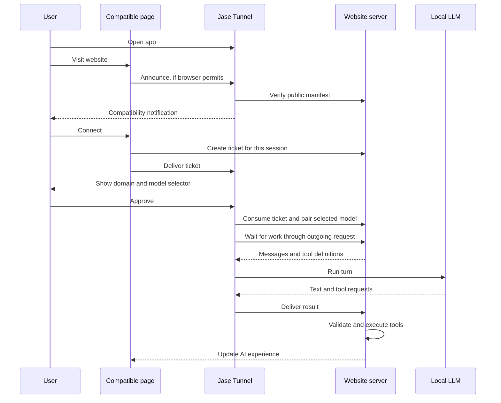

# Jase Tunnel Web Protocol

Design draft 0.1 · October 17, 2026 · proposed identifier: `jase-tunnel-v1`.

This is a proposed specification. Version 0.3 implements discovery, automatic page announcements, rate-limited system notifications, network verification, receipts, native consent, model-bound connections, the broker/SDK and installers for Next.js, Express and `node:http`. The previous single-site protocol was removed. Per-site muting, additional frameworks and a complete browser compatibility matrix remain proposals. This is not yet a complete public standard. MUST, MUST NOT and SHOULD indicate requirements of this proposal.

## 1. User experience

**Download Jase Tunnel, open it and visit a compatible website. The app notifies you that your local LLM can use that website’s tools.**

1. The app stays running and detects available local models.
2. A compatible page announces itself when the browser permits local contact.
3. The tunnel verifies the website’s declaration and displays “This website supports Jase Tunnel: platform.example.”
4. The user chooses **Connect** in the notification or page. The app shows the verified domain, data exchange and model selector; the user confirms in the app.
5. The website’s AI tools use the selected model. The panel shows active connections and lets the user stop them.

No Jase Tunnel account or mandatory browser extension is needed. Websites retain their own sign-in requirements; Tunnel does not make an account-based service anonymous.

Notifications announce compatibility. Model access requires consent in the app. A website can be detected even when no models are ready; the app explains how to start Ollama or LM Studio.

### First browser contact

A normal desktop app does not automatically receive visited URLs. The website MUST cooperate by running the protocol’s web client. A server manifest alone cannot notify the app.

The browser may require permission to contact a local service. When needed, the page displays a detection/connect button and explanation, and contact starts with a user action. With permission already available, the page can announce itself when opened. Tests must verify this behavior for each supported browser.

Automatic behavior is therefore possible **after the browser’s required consent, while both page and app remain active**. Without contact, the app can display “Waiting for compatible websites”; it cannot infer that the visited website is incompatible. An incoming request identifies its browser origin, not necessarily the foreground tab.

## 2. Repository foundations

| Component | Existing code | Required development |
| --- | --- | --- |
| Local service | `main.go`, listening on `127.0.0.1:11439` | Discovery APIs separated from authorized operations |
| Origins | `webOrigin`: public HTTPS, loopback only in development builds | Per-site muting |
| Pairing | Browser ticket exchanged by the app with the server | Native consent, selected model, expiry and revocation |
| Transport | `protocol.go`, outgoing requests to the website broker | Interoperable profile and credentials isolated by website/session |
| Inference | `models.go`, local Ollama and LM Studio | Enforce the authorized model and limits on every turn |
| Tools | Tool schemas and tool-call requests | Providers retain validation and execution responsibility |
| Interface | AppKit, Win32 and GTK 3 | Website list, notifications and consent controls on supported systems |
| Privacy | Tokens and full paths stored locally | No other-site inventories or identifiers in discovery APIs |

The broker and website panel are in `jase-tunnel` (`packages/sdk`); providers install them on their own server.

## 3. Components and responsibilities

Each website integrates a public manifest, a small page client and a server-side broker. The tunnel provides discovery, consent, connections and model adapters.



The server keeps orchestration: receive user requests, construct turns, execute tools and update the page. Every remote tunnel connection starts on the user’s computer and goes to the website server. No inbound router port or third-party relay is needed.

Every available tool MUST have a name, description, JSON argument schema and authorized server-side executor. Publishing the manifest alone does not expose all interface functions to the LLM.

## 4. Compatibility declaration

Fixed path for each origin:

```text
GET https://platform.example/.well-known/jase-tunnel.json
Content-Type: application/json
```

Example:

```json
{
  "name": "Example Platform",
  "protocols": ["jase-tunnel-v1"],
  "broker": "/api/jase-tunnel/v1/",
  "requirements": {
    "capabilities": ["chat", "tool-calls"],
    "contextTokens": 16384
  }
}
```

Manifest rules:

- `name`: 1–80 display characters. The app also shows the actual domain and treats the name as untrusted text.
- `protocols`: implemented protocol versions; this revision requires `jase-tunnel-v1`.
- `broker`: an absolute same-origin path ending in `/`. Absolute URLs, `//` prefixes, queries, fragments, backslashes, `.`/`..` segments and encoded equivalents are forbidden. The app verifies the resulting URL’s origin again.
- `requirements.capabilities`: a subset of `chat`, `tool-calls`, `json-schema`; `chat` is required. Unknown required capabilities make the profile incompatible.
- `requirements.contextTokens`: an integer from 2048 to 262144. Only models with sufficient capabilities and context are offered.
- Maximum size: 16 KiB. Missing or incorrectly typed required fields invalidate the manifest. Extra fields are ignored and never grant permissions.

The page may also declare:

```html
<link rel="jase-tunnel" href="/.well-known/jase-tunnel.json">
```

The HTML link helps integrators. The app always verifies the fixed path on the browser-provided origin. Announcement bodies cannot specify another domain or download URL.

## 5. Local discovery

Proposed local base: `http://127.0.0.1:11439/tunnel/v1/`. This port is a protocol convention, not an officially assigned port. The base profile scans neither ports nor networks. Alternative ports are explicit development configuration only.

### Announcement

The page sends:

```http
POST /tunnel/v1/discover
Origin: https://platform.example
Content-Type: application/json

{"protocol":"jase-tunnel-v1","announce":true}
```

`announce` is optional. `true` means the page announces automatically during browsing; if compatible, the app may notify the user. Without it, a page-button click starts pairing directly, avoiding an unnecessary notification.

The app derives the website exclusively from the verified `Origin` header. It returns `202`:

```json
{
  "protocol": "jase-tunnel-v1",
  "discoveryId": "<random identifier>",
  "receipt": "<temporary secret>",
  "expiresAt": 1792245900000,
  "state": "verifying"
}
```

`discoveryId` contains 16 random bytes encoded as hexadecimal; `receipt` contains 32. The receipt lasts five minutes, stays in page/app memory and is bound to the origin. It is not an inference credential. Timestamps use Unix milliseconds.

The app downloads the public manifest without cookies or credentials. A valid manifest changes the state to `compatible` and may produce a notification. This verifies a domain’s protocol declaration, not its reputation or trustworthiness.

### Request state

```http
GET /tunnel/v1/discovery
Origin: https://platform.example
Authorization: Bearer <receipt>
```

A `200` response includes `protocol`, `discoveryId`, `expiresAt` and `state`. Once paired, it may include only this association’s `connectionId`. It never exposes model names, files, logs, device credentials or other connections.

States: `verifying`, `compatible`, `requested`, `awaiting_approval`, `connecting`, `connected`, `incompatible`, `rejected`, `failed`, `expired`. `compatible` means static checks passed; the broker is checked during pairing. `requested` means the user chose **Connect** in a notification; the waiting page proceeds as if its own button had been clicked. Terminal states are `connected`, `incompatible`, `rejected`, `failed` and `expired`. Unknown or expired receipts produce `410 discovery_expired`; receipts from another origin produce `403 origin_mismatch` without revealing data.

The client polls no more than once every two seconds, stops at a terminal state or expiry, and pauses while the page is hidden. Secrets never enter URLs, logs or persistent browser storage. To avoid announcing again on every same-site page, the receipt is retained in tab-scoped `sessionStorage` only until expiry.

### Notifications

The app MUST retain a panel entry even when system notifications are disabled. Only requests with `announce` produce a notification. **Connect** moves the receipt to `requested` without granting access; the still-open page obtains a server ticket, then the app shows consent. If the page is closed, the panel asks the user to return to it.

The first revision allows at most one notification per origin every 24 hours and three discovery notifications every ten minutes overall, with none for an already connected website. Later discoveries update the panel without another notification. System settings can disable notifications; per-site muting is not yet implemented. Notifications load no remote icons or other resources.

An announcement never reactivates a disconnected or revoked connection. Notifications are local; websites cannot learn whether the user read them.

## 6. Consent and pairing

The page calls same-origin `POST <broker>tickets` after **Connect**, using its website session, CSRF protection and `Cache-Control: no-store`. The body is `{"protocol":"jase-tunnel-v1"}`. A `200` response contains `protocol`, `ticket` and `expiresAt`.

The one-use ticket contains 32 random hexadecimal bytes, lasts at most 120 seconds and is bound to the origin and browser session. The website retains its authentication session and never sends it to the app.

The page delivers the ticket:

```http
POST /tunnel/v1/pair
Origin: https://platform.example
Authorization: Bearer <receipt>
Content-Type: application/json

{"protocol":"jase-tunnel-v1","ticket":"<single-use ticket>"}
```

The app accepts only receipts in `compatible` state and returns `202` with `discoveryId` and `state: "awaiting_approval"`. A second request on the receipt produces `409 pairing_in_progress`. The ticket stays in memory until completion or expiry.

Before calling the remote pairing endpoint, the app MUST display:

- Verified HTTPS origin and website-provided name.
- A model selector limited to models meeting the required profile.
- Notice: “The website will send messages and necessary data to your model. Generated text and tool requests will return to the website’s server.”
- Connection duration and **Allow**/**Decline** buttons.

Consent creates a grant bound to origin, broker, associated session, protocol version, selected model and expiry. The server may request inference only with that model. Consent does not authorize app administration, files, other websites or other sessions.

The implemented desktop caps connections at thirty minutes. Consent and expiry may be stored privately to resume an unexpired connection after restart. Effective expiry is the earlier of local and server expiry. A new session, model, broker or major protocol version requires fresh pairing and consent. An unavailable model pauses the connection without automatic substitution.

After approval, the app calls `POST <broker>pair` with protocol, ticket, a local device label and **only the approved model**, including its context capacity. The broker consumes the ticket atomically and returns `protocol`, `token`, `connectionId`, `expiresAt`. The token contains 32 random hexadecimal bytes; the public identifier contains 16. Credentials are limited to the declared session and expiry.

The app saves the grant and credential privately before requesting work. Failed storage leaves `failed` state and prevents inference. The browser sees only success and its own public identifier through receipt state.

Ticket expiry, rejection or app shutdown interrupts pairing. A new attempt requires user action. The receipt is checked again before the remote exchange. Announcements and browser permission alone never constitute model consent.

### Disconnect and revocation

The panel MUST offer disconnect controls per association and website. Disconnect immediately blocks new inference, cancels active work, removes local credentials and grants, and attempts remote revocation. Network failure cannot restore a local connection.

`POST <broker>revoke` authenticates with the device credential and invalidates its token. Website revocation, expiry or device-endpoint `401`/`403` responses also stop the app connection. Revocation cannot undo tools already executed by the server.

Renewal requires a new ticket and confirmation. Permanently remembering a website is outside the initial profile.

## 7. Turn transport

The first profile reuses `protocol.go` with a website-declared broker path. Device endpoints require `Authorization: Bearer <token>`, protocol in POST JSON and `Cache-Control: no-store` responses.

| Relative broker endpoint | Method | Request and response |
| --- | --- | --- |
| `pair` | POST | Ticket and one-model list → credential, identifier and expiry |
| `models` | POST | Available approved model or empty list → `{"ok":true}` |
| `poll` | POST | `{"protocol":"jase-tunnel-v1"}` → `{"task":null}` or `{"task":{...}}` |
| `active?id=…` | GET | Turn identifier → `{"active":true}` or `false` |
| `result` | POST | `protocol`, `id`, `result` → `{"ok":true}` |
| `revoke` | POST | `{"protocol":"jase-tunnel-v1"}` → `{"ok":true}` |

Successful broker responses use `200`. `tickets` is reserved for the page/session; `pair` consumes a ticket once; other endpoints use device credentials. The broker must never accept `connectionId` as a credential.

`task`, `message`, `tool`, `toolCall` and `turn` derive from the corresponding Go types. Messages carry role and content; tools carry name, description and argument schema; results contain text and JSON tool calls. A stable public specification needs language-independent JSON schemas and fixtures shared with the server SDK.

Every turn MUST be checked against the local grant, even if the server requests a different model. Tools and structured output require their negotiated capabilities. The provider validates tool names, arguments, session permissions and action confirmations.

**The website cannot trust the model.** Visitors can replace the model or impersonate it to the broker. Every tool request must be treated as a direct visitor call to a public API. Tools written for internal agents MUST NOT be exposed without review. Each tool MUST check the request session (`authorize`) or be explicitly safe for every visitor (`public`). Panel confirmation protects the visitor from a manipulated model, not the provider from the visitor. Discovered tools remain disabled until the provider enables them.

Initial limits: 300 messages and 100 tool definitions per turn, at most six tool requests per response, at most 16384 output tokens, context within the approved model’s budget, a turn body of at most 1 MiB, and at most ten minutes within the grant’s expiry. The broker delivers one turn per connection at a time. The app performs at most one inference at a time and enforces expiry while queued.

A broker completes each `poll` within twenty seconds; the app uses a twenty-five-second timeout. `active` checks run every five seconds. Inactive turns, revocation or three consecutive failed checks cancel inference, retaining tolerance for brief network failures. Results are not delivered after cancellation or expiry.

Each turn has a unique association-scoped `id`. The broker accepts one result per ID, treats an identical retry as success and never re-executes tools. It rejects results from other associations, expired turns or cancelled work. The initial profile returns complete responses; streaming and credential refresh require an extension.

Inference runs locally, but conversation content and tool arguments pass through the website server. Weights, local paths and engine tokens remain on the computer.

## 8. Local API boundaries

| Surface | Access |
| --- | --- |
| `POST /tunnel/v1/discover` | Eligible public HTTPS origins; create verification only |
| `GET /tunnel/v1/discovery` | Matching origin and temporary receipt |
| `POST /tunnel/v1/pair` | Verified origin and receipt; open consent |
| Inventory, file choosers, logs, shutdown, local revocation | User-controlled local interface; never granted through web discovery |
| Inference | Authorized broker connection; no public loopback inference endpoint |

The service MUST listen only on loopback and check the exact `Host` header. Web routes require one valid canonical `Origin`; opaque origins, `null`, public HTTP, userinfo, paths, queries and fragments are rejected. Bodies cannot override origins.

CORS responses MUST reflect only the eligible origin for that route, with `Vary: Origin`, expected methods and only `Content-Type`/`Authorization` headers. No wildcard or CORS credentials. Mutations require JSON and bounded bodies. Preflight changes no state and produces no notification. Local management pages need their own protections against external requests and embedding.

Discovery MUST NOT reuse `/v1/status`, which contains model availability and connection information. Merely replacing an origin check with “any HTTPS” is unsafe: administrative operations and remote destinations have separate protection boundaries.

`Origin` and CORS protect browser access; they do not authenticate another program already running on the computer. Local consent and isolated credentials remain necessary.

### Website network verification

New-domain verification makes remote requests controlled by web input. The tunnel MUST:

- Allow only public DNS HTTPS origins on port 443 in production, with normal TLS certificate verification.
- Reject literal IP destinations, local names and resolutions into loopback, private, link-local, multicast, reserved or non-global addresses, including IPv4 embedded in IPv6.
- Check every resolved address and pin the connection to a verified address, retaining hostname and TLS SNI. Repeat for each new connection, including broker access. A DNS check followed by another resolution is insufficient.
- Disable automatic proxies and redirects; never forward credentials to another origin. Limit manifest verification to five seconds, sixteen KiB of body and eight KiB of headers.
- Limit concurrent verification to four and manifest verification to once per origin per minute. Discovery quotas are per-origin (twenty per minute, thirty unexpired receipts) and global (120 per minute, 300 receipts). Only one consent dialog per origin may be open. After **Decline**, that origin cannot reopen it for two minutes; foreground focus is limited to once every thirty seconds. Use `429` and `Retry-After` when necessary.
- Ignore unknown fields in page request bodies; app and SDK updates occur independently.

HTTP loopback website origins require explicit development mode, with state and grants separate from production. Manifest fields cannot enable it.

### Errors

Common format:

```json
{"error":{"code":"unsupported_protocol","message":"Unsupported protocol version."}}
```

Minimum codes: `invalid_request` (400), `unsupported_protocol` (400), `origin_mismatch` (403), `not_authorized` (403), `pairing_in_progress` (409), `discovery_expired` (410), `rate_limited` (429), `broker_unavailable` (502). Asynchronous failures expose state and a code without internal network details, credentials or model inventories. Responses are never cached.

## 9. Browser integration

The web SDK provides discovery, state and pairing, with timeouts, cancellation and browser-state handling. The page must allow loopback in its CSP `connect-src`. The SDK operates in the visible top-level page, not third-party iframes, service workers or hidden tabs.

Connections use `mode: "cors"`, `credentials: "omit"`, `redirect: "error"` and, where supported, `targetAddressSpace: "loopback"`. Feature-detect Permissions API support and handle errors. Absence of that API never proves permission; offer a click-triggered attempt instead.

Failure should say “Cannot reach Jase Tunnel. Check that it is running and that your browser allows local connections.” A network error does not distinguish an absent app, denied permission, CSP or browser blocking. Do not automatically label it “app not installed,” repeat permission requests or scan other ports.

Local Network Access permission is additional to CORS and native app consent. `Access-Control-Allow-Private-Network` alone does not guarantee browser access. Chrome guidance also describes granular local-network and loopback permissions; feature-detect and verify names on tested browser versions.

A custom URL scheme could provide an explicit alternative for opening the app, but requires package registration and verified pairing. It is not implemented and would not provide silent notifications for all browsing.

### Explicit connection window (desktop 0.3.4 / SDK 0.5.2)

Safari blocks the direct HTTPS-to-HTTP loopback fetch. The SDK therefore opens a **top-level** local window at `http://127.0.0.1:11439/tunnel/connect` synchronously within the Connect user action. It MUST NOT open this window from automatic announcements. A random 256-bit channel and expected opener origin travel in the URL fragment; tickets, receipts and credentials MUST NOT appear in any URL.

Both sides MUST validate the exact `MessageEvent.source`, exact sender origin, channel and message type. Every `postMessage` MUST specify the exact destination origin. The local window binds only to its opener and the origin specified for that handshake. No iframe embedding is allowed. Its nonce CSP permits only its own script/style and same-origin requests; external resources, forms and base URLs are forbidden.

The local window uses same-origin JSON POSTs to `/v1/browser-bridge`. The relay MUST require the exact loopback Host and a single local browser Origin, enforce an 8 KiB body limit, and allow only `discover`, `discovery` and `pair`. It MUST reject external requests and all management operations. The eligible website origin is the origin authenticated by the local window's message handler, then checked again by the app's origin and public-network rules. The same origin-bound receipts, ticket exchange, quotas and local model consent MUST apply. No inventory or broker credential is returned through the relay.

The SDK closes its temporary window and removes listeners/timers on completion, error, navigation or timeout. A blocked or prematurely closed window requires a new click. An older app needs updating. A provider's opener-isolation policy can sever the channel; do not weaken or rewrite that policy automatically. Safari automatic announcements remain unavailable; already active broker sessions continue normally.

Verified on Safari **26.6.2** on macOS: direct production HTTPS fetch blocked; isolated corrected client on the same production HTTPS origin opens the local window, verifies the domain and reaches native-consent state. Native consent and cross-origin isolation boundaries also have automated regression tests. No model inference was authorized during this browser check.

Browser references consulted on October 17, 2026:

- [Chrome: Local Network Access](https://developer.chrome.com/blog/local-network-access?hl=en).
- [GoogleChrome: local-network and loopback guidance](https://github.com/GoogleChrome/modern-web-guidance/blob/main/skills/modern-web-guidance/guides/security/local-network-access.md).
- [W3C: Secure Contexts](https://www.w3.org/TR/secure-contexts/).

## 10. Adoption and implementation

A provider publishes the manifest, integrates the page client and implements session-isolated brokerage and tool authorization. No central domain allowlist is required; each person approves their own connections. Code/protocol licensing and name use are documented in the project license and trademark policy.

Implementation order:

1. **Shared contracts:** manifest/message JSON schemas, valid/invalid fixtures, minimal broker and example page.
2. **Discovery:** safe origin verification, separate local APIs, receipts, quotas and panel state, without opening administrative APIs.
3. **Consent and notifications:** model selection, expiring grants, website panel, rejection, muting and revocation, with equivalent supported desktop interfaces.
4. **Transport:** per-grant broker, model enforcement every turn, connection-scoped cancellation, expiry and immediate revocation.
5. **SDK and adoption:** page client, common-framework installers, independent example websites, integrator documentation and a verified compatibility matrix.

The single-site protocol from 0.2 and earlier is gone. Startup discards its credentials and its local endpoints return `404`. Future incompatible changes require a new protocol identifier.

### Acceptance criteria

- Recognize a new provider without modifying or rebuilding the app.
- Display the verified domain even without a ready model or system notifications.
- No inference or model inventory before confirmation.
- Isolate credentials, models and state between two providers and two sessions on the same provider.
- Reject forged origins, redirects, DNS rebinding, private destinations, cross-origin receipts and expired tickets.
- Discovery and polling cannot read other connections, import weights, open file choosers or quit the app.
- Announcements never undo revocation, expiry or rejection; revocation cancels running inference.
- Enforce the chosen model and context even against out-of-profile broker requests.
- Execute each result once and enforce tool authorization.
- Verify Chrome/Edge, Firefox and Safari versions for first contact, permission grant/denial, CSP, app open/closed and page reopening. Claim support only for combinations actually tested.

The first verifiable objective is a complete two-provider demonstration, from page visit and notification through consent to a tool call using the person’s local LLM.
